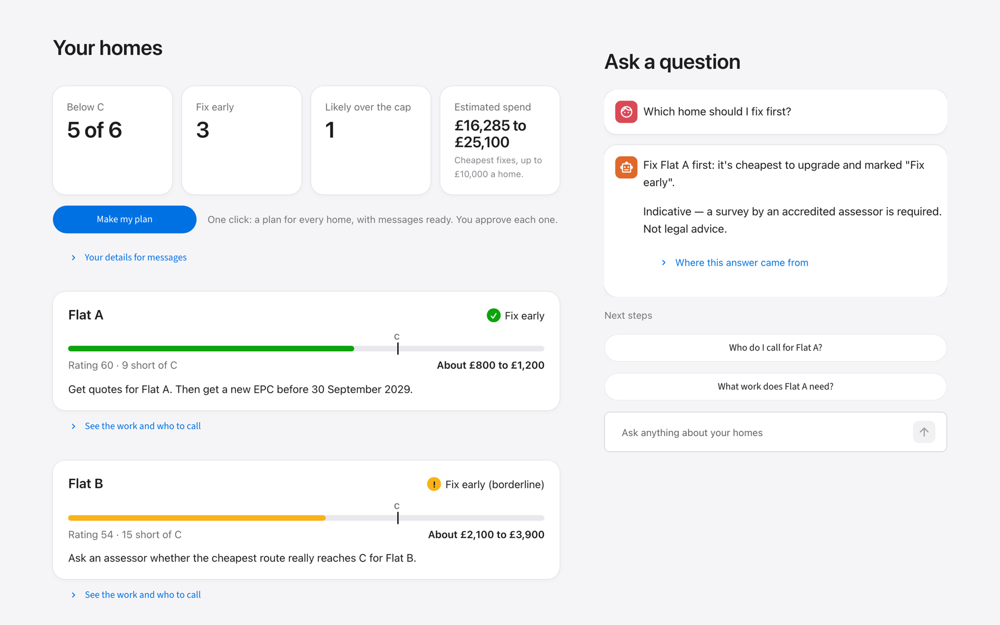
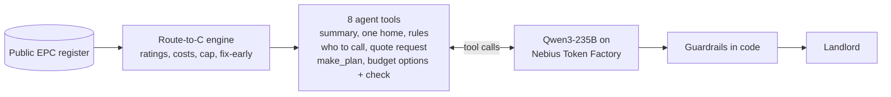

# Route to EPC C: a Nebius Token Factory agent for small landlords

**Live demo: https://nebius-token-factory-hackathon.streamlit.app/**



**In 30 seconds:** a small landlord sees which homes are below EPC C and what the cheapest fix
costs. Then an agent on Nebius Token Factory (Qwen3-235B, 8 tools) answers questions, makes a
plan for every home or one that fits their budget, and gets a message ready for each trade.
Code does the maths and checks the agent's work. Final eval: **30 of 30**, 1.7s per answer,
$1.32 per 1,000 questions. 254 automated tests.

## One user

A landlord with **a few rented homes in Newham** (East London). They're busy, not technical,
and don't have an energy adviser.

## One problem

Under the government's proposals, rented homes in England would need **EPC C by
1 October 2030**. Spend would be capped at **£10,000 per home**, and a C reached by
**30 September 2029** should count until that certificate expires.

The landlord can't tell:
- which of their homes are below C;
- the cheapest way to get each one to C;
- which homes are likely over the cap;
- which homes to fix early.

Paying an assessor to visit every home just to find out costs money and time.

> These rules are **proposals, not yet law** (government response, 21 January 2026). The values
> live in `config/policy.yaml`, with sources.

## One solution

The landlord enters their homes. Each home gets a card showing its rating against the C line,
its status, the cheapest route to C and whether that's likely within the cap. Beside the
results, a chat panel stays in view: they **ask an agent on Nebius Token Factory** anything,
in plain English, and get a next step.

- **Make my plan:** one click plans every home below C, in priority order: who to call, in
  work order, with a quote request for each. "Sort out Flat B for me" plans one home.
- **Plan to my budget:** "I have £8,000 to spend. What should I do?" The agent picks an option
  for each home, code checks the plan, and the agent revises until it passes.
- **Ready-to-send messages:** the landlord types their name and phone once, and every message
  is filled in on the page. They copy it or open it in their own email app. Nothing is sent
  for them.

> **You:** Is House A exempt?
>
> **Agent:** House A has a likely over the cap status. You may be able to register an exemption
> after spending up to £10,000. The exemption process for the 2030 rules isn't published yet.
>
> *Indicative — a survey by an accredited assessor is required. Not legal advice.*

**Code does the maths; the LLM explains.** A deterministic engine works out every rating, cost
and flag from the public EPC register. The agent only explains what the engine's tools return.

## How the Nebius agent works



- **Model:** `Qwen/Qwen3-235B-A22B-Instruct-2507`, called through the OpenAI-compatible Token
  Factory API with tool calling (`src/agent/assistant.py`).
- **Tools** (`src/agent/tools.py`): `get_portfolio_summary`, `get_property`, `get_rules`,
  `find_help` (assessor, installers and engineers, linked to official registers only: GOV.UK,
  TrustMark, MCS), `draft_quote_request`, `make_plan` (`src/agent/plan.py`), and
  `get_budget_options` + `check_budget_plan` (`src/agent/budget.py`). Every number and
  sentence comes from code, not the model.
- **The agent decides, code checks.** For a budget, `get_budget_options` lists what the money
  could buy for each home (cheapest, safer, a boiler route, or just the first few measures).
  The agent chooses. `check_budget_plan` tests the total, the cap, unknown or duplicate choices,
  and whether the plan gets the most homes possible to C. The agent revises until it passes;
  the app only shows a checked plan.
- **Next steps, not just answers.** After each reply the app offers buttons picked by code,
  such as "Who do I call for Flat A?" or "Write to a registered electrician". The landlord's
  details are typed once and never sent to the AI. Nothing is sent automatically.
- **Guardrails enforced in code**, not just asked for in the prompt:
  - **Amounts are checked.** Every £ figure in a reply must appear in the tool output. If one
    doesn't, the model gets one retry; if it's still wrong, the reply is flagged.
  - **Legal conclusions are blocked.** Phrases like "is not exempt" or "must" trigger a retry.
    If they're still there, those sentences are removed.
  - **Claims need evidence.** A reply can only say a message is ready if the draft tool really
    ran that turn, and it can never say it sent, emailed or booked anything. The app never does.
  - **Unchecked plans are flagged.** A budget plan the code didn't pass gets a retry, then a
    visible note.
  - **Short sentences.** A sentence over 25 words gets one retry, per our style guide.
  - **The disclaimer is always added** by code, so the model can't leave it out.
  - **Privacy.** Register addresses never reach the model. It sees UPRNs and the landlord's
    own labels only.

### Why this model

`scripts/eval_models.py` scores Token Factory models on landlord questions, including legal
traps ("Is House A exempt?", "Do I have to by law?") and a question the data can't answer. It
uses real token costs from the models API. Each answer must use a tool, have every £ amount in
the tool output, and pass the wording rules (no legal conclusions, sentences of 25 words or
fewer).

**Final build (24 November 2026):** Qwen3-235B passed **30 of 30**. That's 15 questions, each
asked twice, at **1.7s per answer** and **$1.32 per 1,000 questions**. The questions include:
- the legal traps and the unanswerable question;
- who to call, a quote request, "Make a plan for all my homes" and "Sort out Flat A";
- a budget plan, which must pass the code check and match the best possible result;
- 4 scenarios that start mid-conversation: a bare "yes", "the second one", and an earlier
  reply with a planted wrong cost the agent must re-check.

**Round 1, choosing the model** (6 shorter questions, so costs are lower):

| Model | Passed | Time per answer | Cost per 1,000 questions |
|---|---|---|---|
| **Qwen3-235B-A22B-Instruct-2507** | **6/6** | **1.4s** | **$0.65** |
| DeepSeek-V4.1-Flash | 6/6 | 4.0s | $1.45 |
| GLM-5.3-Flash | 5/6 | 10.3s | $0.66 |
| gpt-oss-120b | 4/6 | 1.5s | $0.60 |
| Qwen3-30B-A3B-Instruct-2507 | 3/6 | 2.8s | $0.23 |
| Nemotron-3.5-Lightning | 2/6 | 1.6s | $0.28 |

Qwen3-235B passed everything and was the fastest of the top two. Reading the answers by hand
also found bugs the scores missed, such as an invented exemption rule. They're fixed, with
regression tests.

## Origin

Standalone copy of the core of the `route-to-c` project (engine, address lookup, report,
policy config), made for the hackathon. See `docs/decisions.md` (ADR-001).

## Setup

```bash
uv sync
cp .env.example .env            # add NEBIUS_API_KEY and NEBIUS_MODEL
uv run --env-file .env python scripts/snapshot.py   # one-off copy of the data from MotherDuck
uv run pytest
uv run --env-file .env streamlit run app.py                # the demo
```

## Hosted demo (Streamlit Community Cloud)

The public app runs in **demo mode**: it's on whenever `data/epc.duckdb` is missing, so a hosted
copy can never reach register data. It shows 6 example homes from
`examples/demo_portfolio.json` (UPRNs and EPC fields only, no addresses; regenerate with
`uv run python scripts/export_demo.py`), has no address entry, and caps chat at 10 questions
per visitor and 300 a day. Set `NEBIUS_API_KEY` and `NEBIUS_MODEL` in the app's Secrets.
Preview it locally with `DEMO_MODE=1`.

Re-run the model comparison with `uv run --env-file .env python scripts/eval_models.py`. Use
`--repeat 3` to check stability, or `--questions file.txt` to rehearse your own questions. Read
the answers too: the automatic checks don't catch every invented claim.

## Layout

| Path | What |
|---|---|
| `src/engine/` | Route-to-C engine: cheapest set of measures reaching SAP 69, cap and lock-in flags |
| `src/lookup/` | Address → UPRN matching (strict; wrong match is worse than none) |
| `src/report/` | HTML portfolio report |
| `src/agent/` | Nebius tool-calling assistant: tools over engine output, guardrails, plans (`plan.py`) and budget options and checks (`budget.py`). `python -m agent.assistant` for a terminal chat |
| `app.py` | Streamlit demo: enter homes (or try 6 example homes) → cards → chat beside them. Logic in `src/webapp/` |
| `config/policy.yaml` | MEES dates, cost cap, penalties with sources |
| `scripts/snapshot.py` | Copies the needed tables to `data/epc.duckdb` |
| `scripts/eval_models.py` | Scores Nebius models on landlord questions, with real costs |
| `scripts/export_demo.py` | Writes the hosted demo's 6 homes to `examples/demo_portfolio.json` (no addresses) |

## Data and licence

EPC register data (MHCLG). Non-address fields and UPRNs: Open Government Licence v3.0.
Address and postcode fields are restricted to energy-efficiency purposes, so the local
database is gitignored and addresses are only shown for properties the user enters.
See `docs/data_access.md` §3.
